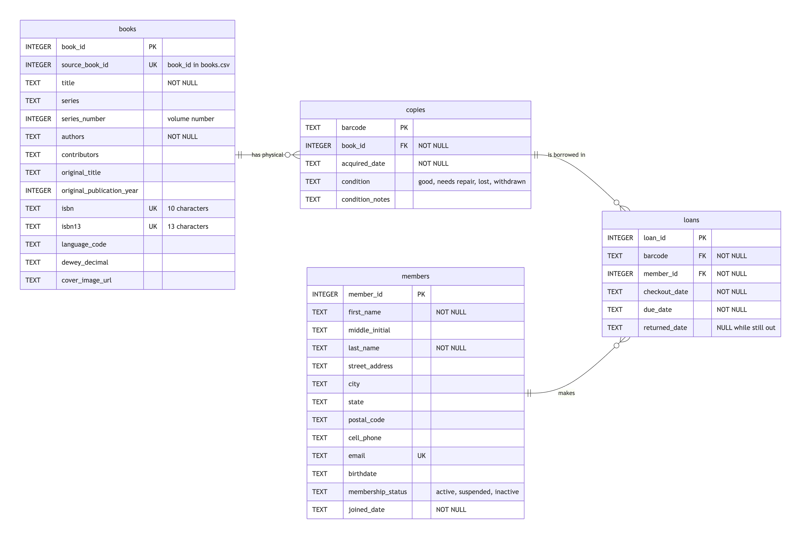
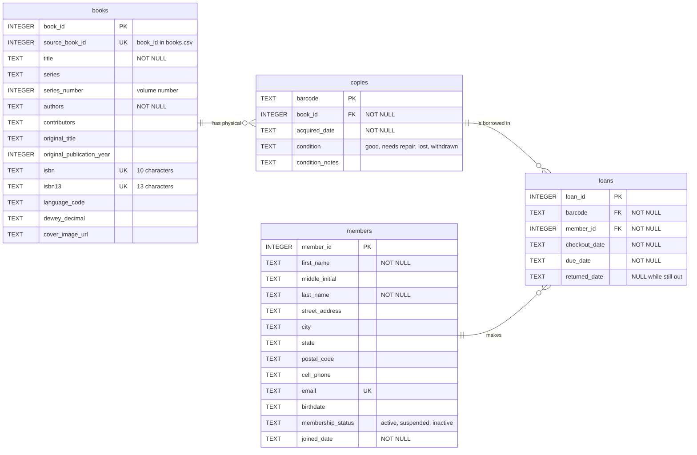

# Library Database: Entity-Relationship Diagram

Mermaid source for this diagram

## Summary

The Library Database is composed of four different tables:

Books - This data table is to identify the unique characteristics of each of the books available in the library.

Copies - This data table introduces the "barcode" data field which is a unique identifier for each physical copy of the books.  This data table is used as a precursor for the Loans data table.

Members - This data table is to identify the unique members of the library and their important information (demographics, contact information, etc.).

Loans - This data table is to keep track of the check in or check out status of each of the books identified by their unique barcode value.

There are several key linking data fields in this database used to connect the data tables together.

book_id - This data value is a unique identifier tied to the Author and the Title of the book. It connects the Books table and the Copies table in a one-to-many relationship since a book author and title can have more than one physical copy of the book in the library's inventory.

barcode - This data value is a unique identifier tied to the physical copy of the book.  It connects the Copies table and the Loans table in a one-to-many relationship since a book can be borrowed and returned a number of times.

member_id - This data value is a unique identifier for each person who is or was a member able to check out books.  This data field has a one-to-many relationship to the Loans table since a single person is able to check out more than one book at a time.

If you take historical check out records into consideration, there could also be a many-to-many relationship between the Members and Copies data tables since both of those tables connect to the Loans data table.

There were several design decisions that I instructed Claude Code to take into consideration:

1. I asked Claude to review all 25 rows used in the books.csv file that we planned to use since I suspected that some of the data elements beyond the first 5 rows that Claude originally checked may have errors.  Claude reviewed all 25 rows and did find additional errors.  Instead of using the 25 rows from the original books.csv file, I asked Claude to make a new books_25_clean.csv file where Claude fixed all of the errors found in the data.  The key lesson to be learned here is that you cannot assume that the personality of the data set can be fully determined within the first few rows of the data set.  Only with a thorough understanding of all of the data in your data set can you accurately determine the design of the fields in your database.  Also, you need to be careful not to propagate the errors from the previous data set into your new data set which will just end up creating more problems for you if the errors are not cleaned up.

2. Claude suggested that a separate table for Author information be created as well in the database.  After thinking about how the data in the Author table would be used, I told Claude not to create a separate Author table.  The reason is that the author information should be tied directly to the book information.  Adding a separate data table just for author information would be adding additional complexity to the design of the database without adding any additional value.  This added complexity also creates another source of potential errors which could impact the operations of the database.

3. The books.csv file did not contain the Dewey Decimal information for the books in its data set.  Since this is an additional valid way of identifying and searching for books, I asked Claude to research and find the Dewey Decimal information for each of the titles, and then add that information to the books_25_clean.csv file.  Claude had to go to the Library of Congress to get that information for our data set.  Claude was only able to find the Dewey Decimal information for only 17 out of the 25 book titles.  Claude determined the Dewey Decimal information for the remaining titles by looking for Dewey Decimal information for similar titles in the same series from the author. 

As far as errors were concerned, I did notice that Claude listed the dates in the database in a text format.  I asked Claude about changing the date field into a date format so that mathematical operations could be performed against the dates.  Claude confirmed that even in the text format that the mathematical operations were still able to be done.  However, Claude did point out that the dates could be entered into the database in a number of different date formats.  In order to ensure consistency in the date formats, I asked Claude to add some date formatting rules to the database.

Claude updated the programming for the database so that all dates must be recorded in the yyyy-mm-dd format.  Claude even tested out this rule by using different date formats to ensure that the formatting rules allowed only the correct formatting to be entered.

Another error that I encountered was when I asked Claude to prepare the ERD diagram.  The ERD diagram that it first created formatted the diagram in a vertical format, and the Claude app's side panel would not let me scroll down far enough to view the data table design at the very bottom of the ERD diagram.  As a result, Claude had to redesign the ERD in a horizontal format.  With the new horizontal format, I was able to fully inspect all of the data table designs.

      